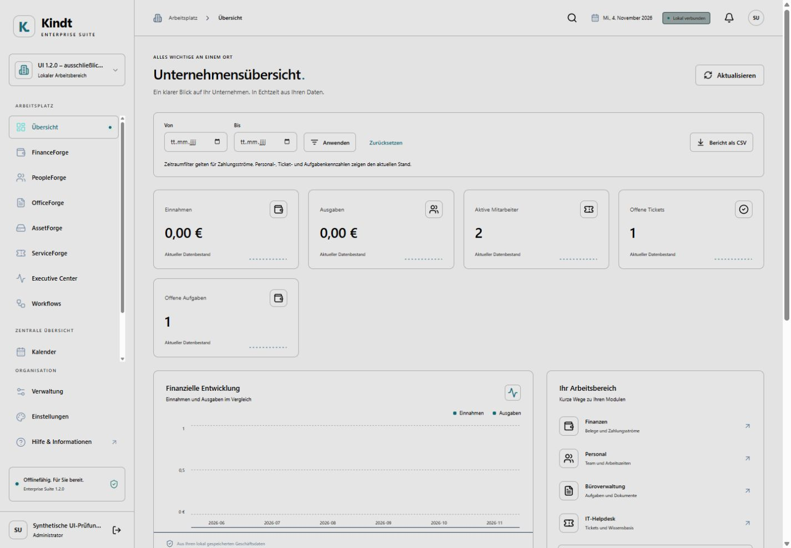
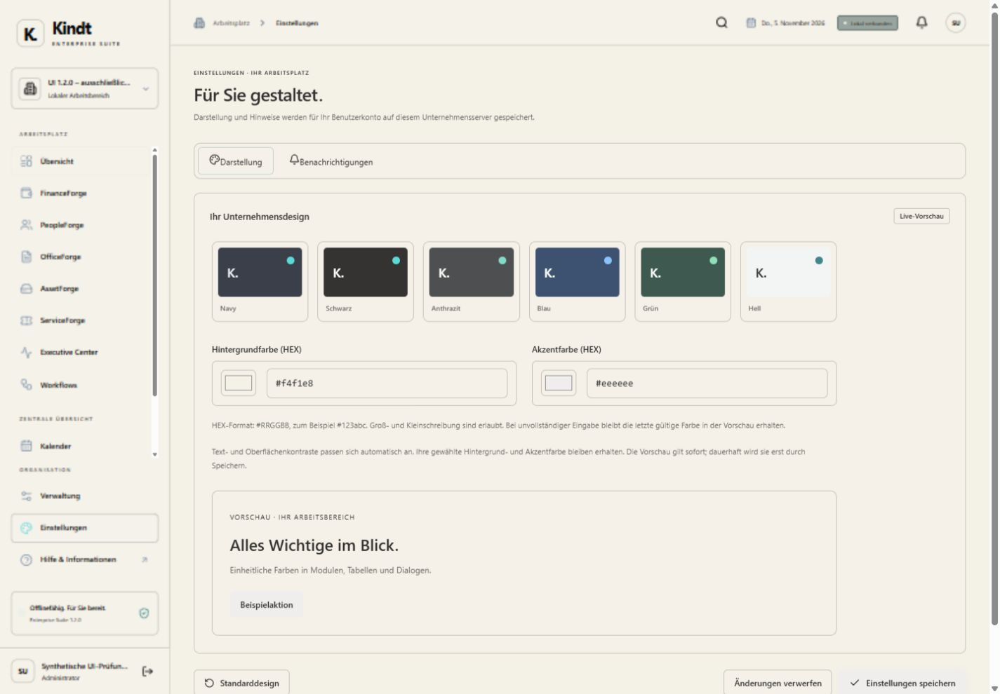
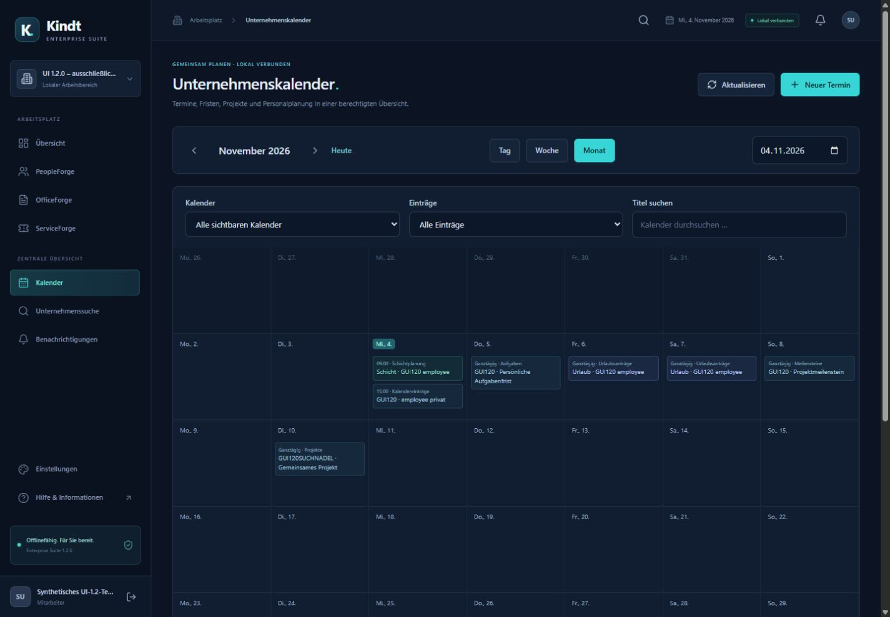
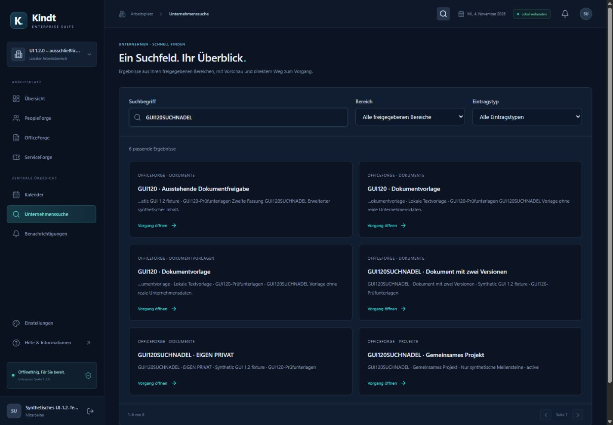
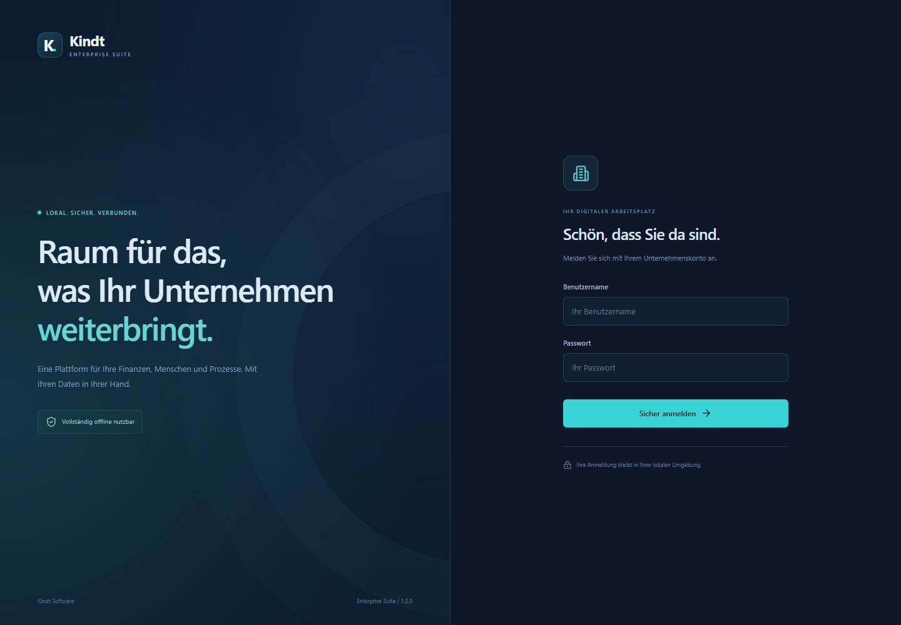

# Kindt Enterprise Suite 1.2.0

**Deutsche Verwaltungssoftware für Windows und Linux. Lokal betrieben, vollständig offline nutzbar, kostenlos für nichtkommerzielle Nutzung.**

Kindt Enterprise Suite verbindet Unternehmensverwaltung, Dokumente, Kalender, Finanzen, Personal, Inventar und Service in einer gemeinsamen Oberfläche. Die Software ist proprietär und **Closed Source**. Sie enthält keine Abonnements, benötigt kein Herstellerkonto und keine Online-Aktivierung. Kommerzielle Nutzung durch Dritte setzt die vorherige Erlaubnis von Kindt-Software voraus. [Nutzungsbedingungen](PRODUKTNUTZUNG_1_2.txt).

Diese GitHub-Preview präsentiert den bestehenden Funktionsstand **1.2.0**. Die Linux-Downloads enthalten die bereits geprüften nativen Programme samt vollständigen Lizenz-/Quellenbeilagen und den Bedingungen der kostenlosen Edition. Es wurden dafür keine neuen Anwendungsfunktionen entwickelt. Die ursprünglichen FINAL-Archive bleiben erhalten.

## Download

**Linux Desktop und Server – Version 1.2.0 Preview**

[Linux-Version herunterladen](https://github.com/neurogitlab-dot/kindt-enterprise-suite/releases/tag/v1.2.0-preview)

Windows-Version: derzeit noch nicht öffentlich verfügbar.

**Kostenlos · Closed Source · Offline nutzbar**

## Funktionen

| Arbeitsbereich | Enthaltene Funktionen |
| --- | --- |
| Core | Unternehmen, Benutzer, Rollen, Modulfreigaben, Audit und Sicherungen |
| FinanceForge | Kontakte, Angebote, Rechnungen, Vorlagen, wiederkehrende Entwürfe, interne Mahnverläufe und Finanzübersichten |
| PeopleForge | Personal, Urlaub, Abwesenheiten, Zeiterfassung, Schichtplanung und persönliche Kalender |
| OfficeForge | Dokumente, Dateiversionen, Kategorien, Textvorschau und Vergleich, Archiv, Aufgaben und Freigaben |
| AssetForge / ServiceForge | Inventar, Softwarelizenzen und Wartungen; Tickets, Kommentare und Wissensartikel |
| Executive Center | Kennzahlen, persönliche Dashboards, Diagramme, Filter und PDF-/CSV-Berichte |
| Workflow-Designer | Visuelle Abläufe mit Auslösern, Bedingungen, Aktionen, Freigaben, Vorlagen, Testmodus und Protokollierung |

Version 1.2.0 ergänzt den Dokumentarbeitsplatz, den Unternehmenskalender, persönliche Benachrichtigungen, die globale Suche und persönliche Designs mit direkten HEX-Feldern. Rollen und private Sichtbarkeit werden serverseitig geprüft. [Ausführliche Funktionsübersicht](docs/FEATURES.md).

## Offline und ohne externe Registrierung

Die mitgelieferte Oberfläche läuft im vorhandenen Browser und wird durch einen nativen Starter geöffnet. Nach vorbereiteter Installation funktionieren die Kernmodule ohne Internet, Cloud- oder KI-Dienst. Bibliotheken, Schriften und Designdaten werden im Produktbetrieb lokal bereitgestellt.

Es ist keine Registrierung bei Kindt-Software, kein Abonnement und keine Internetaktivierung erforderlich. Beim ersten Start wird ein **lokales Administratorkonto** eingerichtet. Weitere lokale Benutzer und Anmeldungen dienen dem Zugriffsschutz; sie sind keine externe Registrierung. Der laufende Betrieb benötigt auch kein GitHub-Konto. Für Windows ist später eine individuelle Übergabe mit vorheriger Vereinbarung vorgesehen; das begründet kein Herstellerkonto.

| Plattform / Profil | Einsatz | Downloadstatus dieser Preview |
| --- | --- | --- |
| Linux x86-64 Desktop | Lokales SQLite-Paket | Für öffentliche Bereitstellung vorbereitet |
| Linux x86-64 Server | Serverstarter mit PostgreSQL-Anbindung | Für öffentliche Bereitstellung vorbereitet |
| Windows x64 Desktop | Lokales SQLite-Paket | Kein öffentlicher Download; Weitergabe noch gesperrt |
| Windows x64 Server | Serverstarter mit PostgreSQL-Anbindung | Kein öffentlicher Download; Weitergabe noch gesperrt |

Die öffentlichen Linux-Downloads heißen `kindt-enterprise-suite-1.2.0-linux-x86_64-desktop-free.zip` und `kindt-enterprise-suite-1.2.0-linux-x86_64-server-free.zip`. Jede Vertriebshülle enthält die unveränderte geprüfte Anwendung, vollständige zugehörige Drittbeilagen, Lizenz und Produktbedingungen. Nur diese vollständigen Lieferpakete verwenden. SHA-256 steht im Release unter `SHA256SUMS`. Es wird hier keine bereits erfolgte Veröffentlichung behauptet.

Linux ist auf Ubuntu 26.04.1 LTS x86-64 mit glibc 2.43 abgenommen. Andere Distributionen und ältere glibc-Versionen sind dadurch nicht freigegeben. Windows benötigt Windows 10 oder neuer mit x64. PostgreSQL-Server, passende Sicherungswerkzeuge und betriebliche TLS-Zertifikate sind separat vorzubereiten. Ein Suite-Prozess bedient mehrere Browserclients. [Installation und LAN-HTTPS](docs/INSTALLATION.md).

## Einblicke

## Screenshots

### Dashboard

### Individuelle Designs

### Unternehmenskalender

### Globale Suche

### Anmeldung

Tatsächliche Windows-Browseraufnahme mit ausschließlich synthetischen Abnahmedaten. [Weitere Ansichten: Übersicht, Suche, Anmeldung und persönliche Farben](docs/SCREENSHOTS.md). Die Bilder illustrieren die Anwendung und erteilen keine Windows-Downloadfreigabe.

## Dokumentation

- [Installation, lokales Konto und Serverbetrieb](docs/INSTALLATION.md)
- [Upgrade, Sicherung und Rückfall](docs/UPGRADE.md)
- [Release Notes](docs/RELEASE_NOTES.md)
- [Downloadumfang und Lizenzbeilagen](docs/DISTRIBUTION.md)
- [Bekannte Grenzen](docs/LIMITATIONS.md)
- [Windows-Bezug und Bedingungen](docs/WINDOWS_DOWNLOAD.md)
- [Wiederverwendete Prüfergebnisse](docs/CLEARANCE.md)

## Lizenz und Nutzung

Es gilt die unveränderte [Kindt Software Proprietary License v1.0](LICENSE.txt), ergänzt für diese kostenlose Ausgabe durch die [produktspezifischen Nutzungsbedingungen](PRODUKTNUTZUNG_1_2.txt). Kostenlos bedeutet **kein Open Source** und keine Erlaubnis zur eigenständigen Weiterverbreitung oder kommerziellen Nutzung. Kommerzielle Nutzung kann bei kindt.software@proton.me angefragt werden; eine Anfrage ist noch keine Erlaubnis.

Die Bedingungen betreffen die eigene Kindt-Software. Rechte aus Drittanbieter-Lizenzen, notwendige Copyright-Hinweise, Bibliotheksrechte und vorgeschriebene Fremdquellen bleiben vollständig erhalten. Die Suite ersetzt keine vollständige Steuer- oder Lohnbuchhaltung; eine DATEV-, Arbeitsrechts- oder sonstige vollständige Rechtskonformität wird nicht zugesagt.
